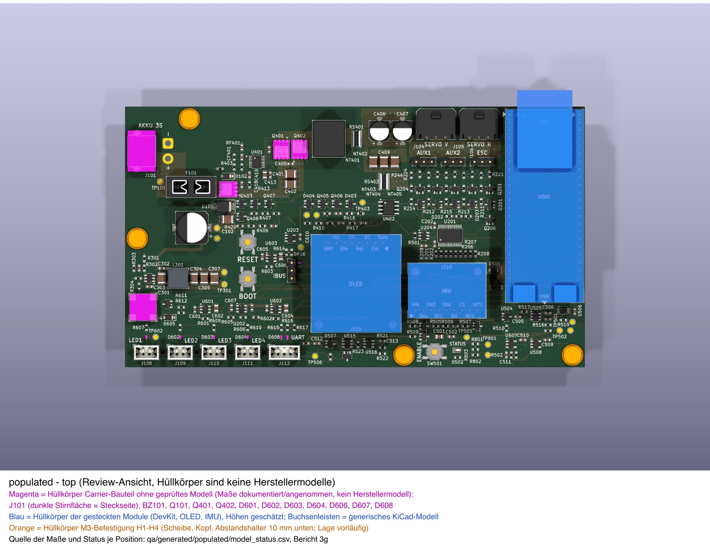
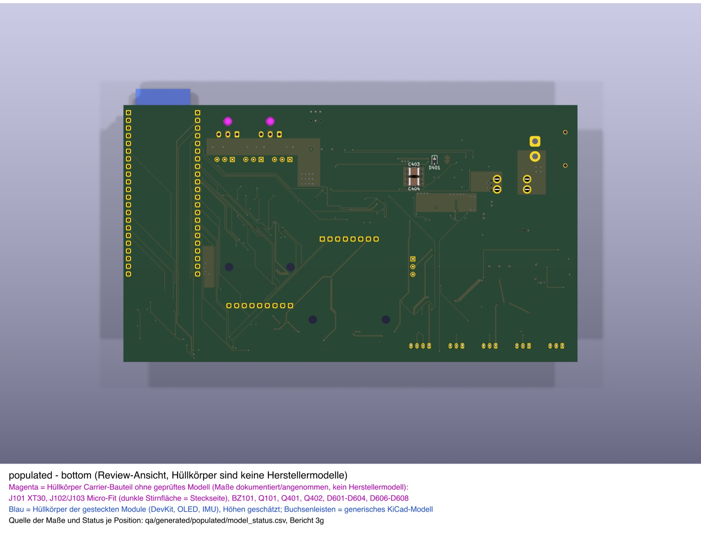
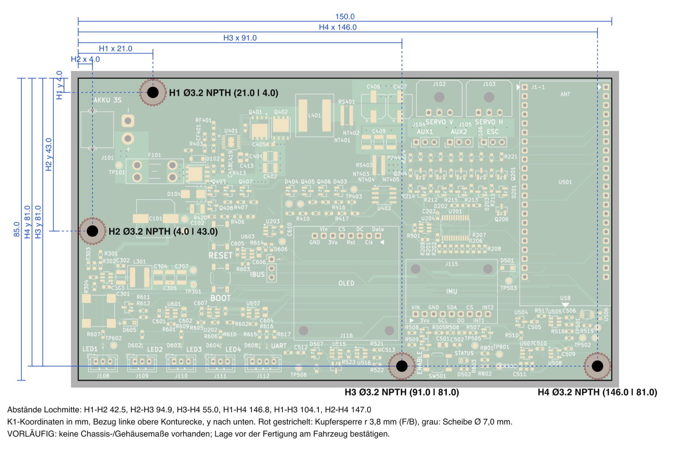

# RoverCore

Modulare VCU-Trägerplatine (Rev 1) für einen RC-Rover: steckbares
ESP32-S3-DevKitC-1, IMU (Adafruit 4438), OLED (Adafruit 326), geregelte
Servoschiene, 5-V-Logikversorgung, LED-, Empfänger- und UART-Ausgänge.
KiCad 10.0.7, 4 Lagen, 150 × 85 mm.

**Stand 2026-11-18: Layout geschlossen, DRAFT-Fertigungspaket A1 (NO-GO).**
ERC, DRC und Schaltplan-Parität bestehen im lokalen Lauf. Der
JLCPCB-Regelsatz im DRC prüft Kupfer, Bohrungen und Texte, aber keine
Linienbreiten im Bestückungsdruck (bekannte Abweichung, siehe unten). Das ist ein Werkzeugergebnis; elektrische, thermische und
fertigungstechnische Freigabe stehen aus. Nächster Schritt ist der
prüfbare Prototyp nach dem [Inbetriebnahmeplan](docs/bringup.md).


## Ansichten

Review-Ansichten (`hardware/scripts/render_populated_review.py`): Bauteile mit
KiCad-Bibliotheksmodell erscheinen normal. **Magenta** sind gekennzeichnete
Hüllkörper für Carrier-Teile ohne verfügbares Modell (J101 XT30 mit dunkler
Stirnfläche auf der Steckseite, BZ101, Q101, Q401, Q402, D601–D604,
D606–D608). J102/J103 zeigen das Molex-Herstellermodell (projektlokal, nicht
in Git; Quelle und Prüfsumme in `hardware/libraries/3d-models/models.csv`). **Blau** sind Hüllkörper der gesteckten Module
(DevKit, OLED, IMU). Hüllkörper sind keine Herstellermodelle; ihre Maße und
Quellen stehen in `qa/generated/populated/model_status.csv` und im Bericht
(3g, 3l).

| Mit Modulen | Ohne Module (Buchsenleisten) |
|---|---|
|  |  |
|  |  |
|  |  |
|  |  |

Befestigung (vorläufig, Bericht 3n): vier M3-Bohrungen, NPTH 3,2 mm; orange in
den 3D-Ansichten = Hüllkörper für Scheibe, Kopf und 10-mm-Abstandshalter.



Aus den exportierten Gerber- und Bohrdateien gezeichnet
(`hardware/scripts/gerber_preview.py`), also so, wie der Fertiger sie erhält:

| Oberseite (Gerber) | Unterseite (Gerber, von unten) | Innenlage In1 (GND) |
|---|---|---|
|  |  |  |

## Eckdaten (Auslegung, nicht gemessen)

| Größe | Wert |
|---|---|
| Eingang | 3S-LiPo, 9,0–12,6 V, XT30, Sicherung 15 A, Verpolschutz Q101, TVS D101 |
| Servoschiene | LTC7803, Sollwert 6,8 V (vorläufig, O-19), Auslegung 11,2 A (zwei blockierte Lenkservos), Strommessung INA240A3 an 2 mΩ |
| Logik | TPS54302, +5V 4,74–5,16 V; DevKit über D501 (PMEG4010CEH), +3V3 aus dem DevKit-LDO |
| Freigabe | `SERVO_PWR_EN` und Freigabe-Latch (SW501, Wiederanlaufsperre 9,62–10,40 V) |
| Lagenaufbau | Fertigungsvorgabe 35 / 17,5 / 17,5 / 35 µm, Prepreg 0,1 mm, 1,6 mm, Hülse IPC-6012 Kl. 2 – beim Fertiger zu bestätigen |

## Dokumentation

| Dokument | Inhalt |
|---|---|
| [Erstinbetriebnahme](docs/bringup.md) | Schrittfolge Versorgung, D501, Servostrompfad, Grenzwerte und Abbruchkriterien |
| [Versorgung und Boardwahl](docs/vcu/rev1-versorgung-und-boardwahl.md) | Auslegung aller Versorgungen, Schutz, Wiederanlaufsperre |
| [Pin- und Anschlussplan](docs/vcu/rev1-pin-und-anschlussplan.md) | GPIO-Belegung, Stecker (maschinenlesbar: `hardware/interfaces/pinmap.csv`) |
| [Platzierung, Routing, Fertigung](docs/vcu/rev1-platzierung.md) | Platzierung, Routing K1, Strompfade (3j), Fertigerabgleich und DRAFT-Paket (3k) |
| [Mechanischer Abgleich](docs/vcu/rev1-mechanik-abgleich.md) | Prüfliste am Fahrzeug, 1:1-Vorlage, Auflage unter dem DevKit |
| [Review 2026-11-15](docs/vcu/rev1-review-2026-11-15.md) · [Werkzeuge](docs/vcu/tooling-integration.md) | Schaltplan-Review, lokale Werkzeuge |
| [Engineering-Richtlinien](docs/engineering/README.md) | allgemeine Regeln aus dem Template |

Online: <https://cagricatik.github.io/RoverCore/>

## Offen vor einer Bestellung

- Lagenaufbau und **Mindest**-Hülsendicke 18 µm schriftlich beim Fertiger
  bestellen (JLCPCB nennt nur einen Mittelwert von 18 µm).
- D502 (Status-LED): Typ und Teilenummer festlegen (O-28).
- Datenblattfelder (44 Teile), 3D-Modelle (14), Bauteilakten.
- Bestückungsdruck: 1 211 Umrissstriche mit 0,12 mm im exportierten Gerber
  (JLCPCB verlangt 0,15 mm); Entscheidung offen (Bericht 3l).
- Befestigung: vier M3-NPTH-Bohrungen H1–H4 gesetzt, Lage **vorläufig** (keine
  Chassismaße); vor der Fertigung am Fahrzeug abgleichen
  ([Prüfliste](docs/vcu/rev1-mechanik-abgleich.md)), Auflage unter dem DevKit vorsehen.
- Bohrdatei: PTH/NPTH getrennt hochladen und die 10 NPTH-Löcher in der
  Fertiger-Vorschau prüfen (Bericht 3n).
- 3D: Herstellermodelle für XT30, BZ101, Q101, Q401/Q402, D601–D608 sowie
  DevKit, OLED und IMU fehlen noch (Download-Stand je Teil im Bericht 3m).
  J102/J103 haben das Molex-Modell.
- GO-Freigabe nur mit signierter Freigabe (`manufacturing/approval.example.json`)
  und `--authorize`.

## Repository

| Pfad | Inhalt |
| --- | --- |
| `RoverCore.kicad_pro/.kicad_sch/.kicad_pcb/.kicad_dru` | KiCad-Projekt (Hardware-Wahrheit), Fertiger-Regelsatz |
| `hardware/` | Eigene Bibliotheken (`${KIPRJMOD}`), Schnittstellen, Simulation, Board-Skripte |
| `firmware/` | Firmware, BSP und Treiber (optional) |
| `components/` | Bauteilakten, Datenblätter, SPICE-Modelle |
| `manufacturing/` | Freigabe-Checkliste, Freigaben, erzeugte Exporte (nicht versioniert) |
| `docs/` | Anforderungen, Architektur, Schnittstellen, Inbetriebnahme, Berichte |
| `qa/` | Prüfkonfiguration, Reviews, Berichte |

## Befehle

```sh
scripts/kit install                       # einmalig: lokale .venv (kicad-python, numpy, scipy)
scripts/kit doctor                        # Umgebungsdiagnose, nur lesend
scripts/kit verify .                      # ERC, DRC, Parität, Bibliotheken, Metadaten, 3D, BOM
scripts/kit export . --revision A1        # DRAFT-Fertigungspaket (NO-GO)
scripts/kit thermal analyze .             # stationäre Thermik-Schätzung
```

Prüfung eines DRAFT-Pakets gegen das Board und Gerber-Vorschau:

```sh
/Applications/KiCad/KiCad.app/Contents/Frameworks/Python.framework/Versions/Current/bin/python3 \
  hardware/scripts/fab_package_check.py RoverCore.kicad_pcb manufacturing/releases/generated/rev-A1-DRAFT
python3 -I hardware/scripts/gerber_preview.py manufacturing/releases/generated/rev-A1-DRAFT qa/generated/fab
```

Die Werkzeuge sind aus PCB-Project-Template 2.0.0 übernommen; Herkunft,
Lizenz und lokale Änderungen stehen in [`tools/VENDORED.md`](tools/VENDORED.md).
Regeln für automatisierte Änderungen: [`AGENTS.md`](AGENTS.md).
