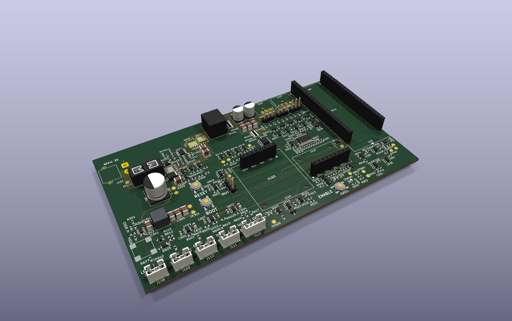
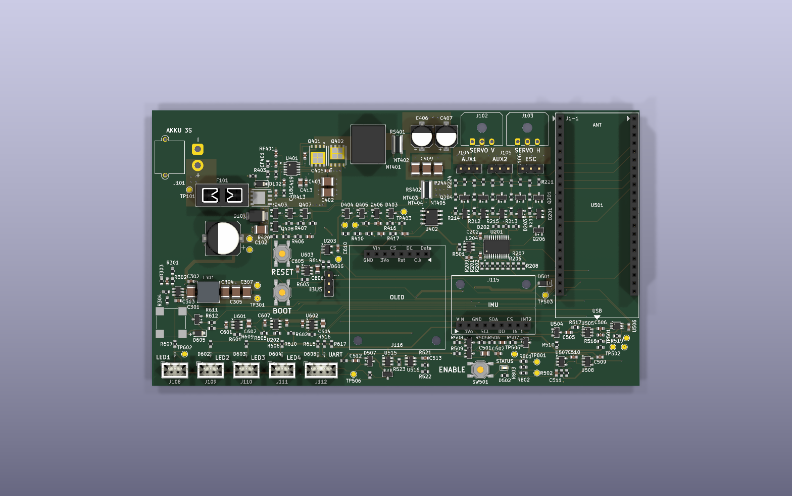
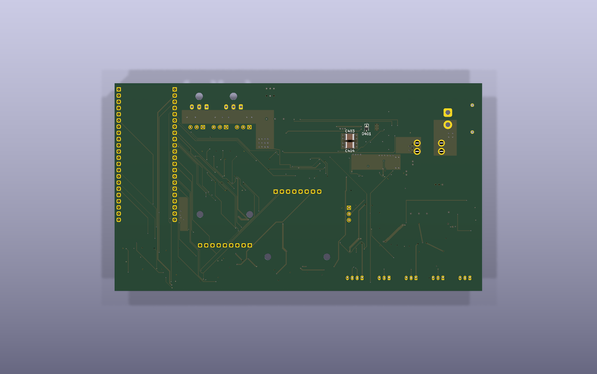

# RoverCore VCU Rev 1

Modulare VCU-Trägerplatine für einen RC-Rover: steckbares ESP32-S3-DevKitC-1,
IMU, OLED, geregelte Servoschiene (LTC7803, 6,8 V vorläufig, Auslegung 11,2 A),
5-V-Logikversorgung (TPS54302), LED-, Empfänger- und UART-Ausgänge.
KiCad 10.0.7, 4 Lagen, 150 × 85 mm.

!!! warning "Stand 2026-11-18: DRAFT A1 – NOT FOR FABRICATION"
    Layout geschlossen; ERC, DRC (JLCPCB-Regelsatz) und Parität bestehen im
    lokalen Lauf. Das ist ein Werkzeugergebnis. Alle Strom-, Spannungs- und
    Temperaturwerte in dieser Dokumentation sind Rechen- oder Datenblattwerte;
    sie werden am Muster nach der [Erstinbetriebnahme](bringup.md) geprüft.

| Oberseite | Unterseite |
|---|---|
|  |  |
| **Schräg von hinten** | **Flach von vorne** |
|  |  |

Aus den exportierten Gerber- und Bohrdateien gezeichnet:

| Oberseite | Unterseite (von unten) | Innenlage In1 (GND) |
|---|---|---|
|  |  |  |

Teile ohne Herstellermodell (14, u. a. J102/J103, BZ101) fehlen in den
3D-Ansichten.

## Einstieg

- [Erstinbetriebnahme](bringup.md): Versorgung, D501, Servostrompfad, Abbruchkriterien
- [Versorgung und Boardwahl](vcu/rev1-versorgung-und-boardwahl.md)
- [Pin- und Anschlussplan](vcu/rev1-pin-und-anschlussplan.md)
- [Platzierung, Routing, Fertigung](vcu/rev1-platzierung.md): Strompfade (3j), Fertigerabgleich und DRAFT-Paket (3k)
- Quellen: [GitHub](https://github.com/CagriCatik/RoverCore)
