# RoverCore VCU Rev 1

Modulare VCU-Trägerplatine für einen RC-Rover: steckbares ESP32-S3-DevKitC-1,
IMU, OLED, geregelte Servoschiene (LTC7803, 6,8 V vorläufig, Auslegung 11,2 A),
5-V-Logikversorgung (TPS54302), LED-, Empfänger- und UART-Ausgänge.
KiCad 10.0.7, 4 Lagen, 150 × 85 mm.

!!! warning "Stand 2026-11-18: DRAFT A1 – NOT FOR FABRICATION"
    Layout geschlossen; ERC, DRC und Parität bestehen im lokalen Lauf. Das
    ist ein Werkzeugergebnis. Offen vor der Fertigung: Linienbreite im
    Bestückungsdruck und mechanische Befestigung (Bericht 3l). Alle Strom-, Spannungs- und
    Temperaturwerte in dieser Dokumentation sind Rechen- oder Datenblattwerte;
    sie werden am Muster nach der [Erstinbetriebnahme](bringup.md) geprüft.

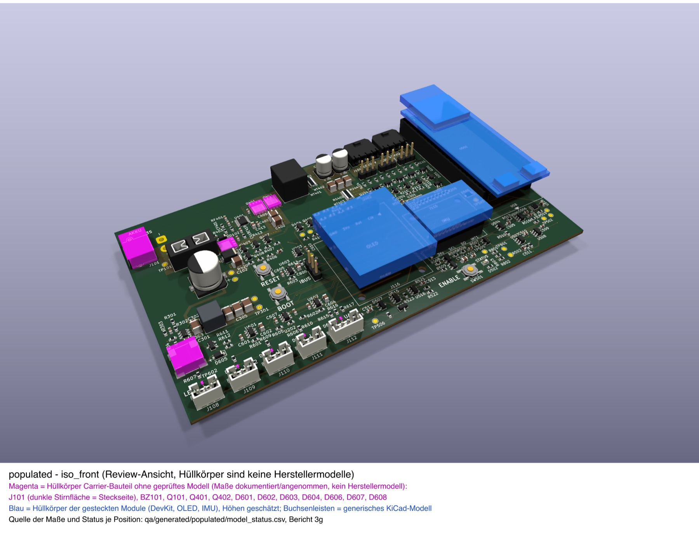

**Magenta** = gekennzeichnete Hüllkörper für Carrier-Teile ohne verfügbares
Modell (XT30 mit dunkler Steckseite, Buzzer, Leistungs-FETs, X2SON-Dioden);
**blau** = Hüllkörper der gesteckten Module (DevKit, OLED, IMU). J102/J103
zeigen das Molex-Herstellermodell.
Hüllkörper sind keine Herstellermodelle.

| Mit Modulen | Ohne Module |
|---|---|
|  | 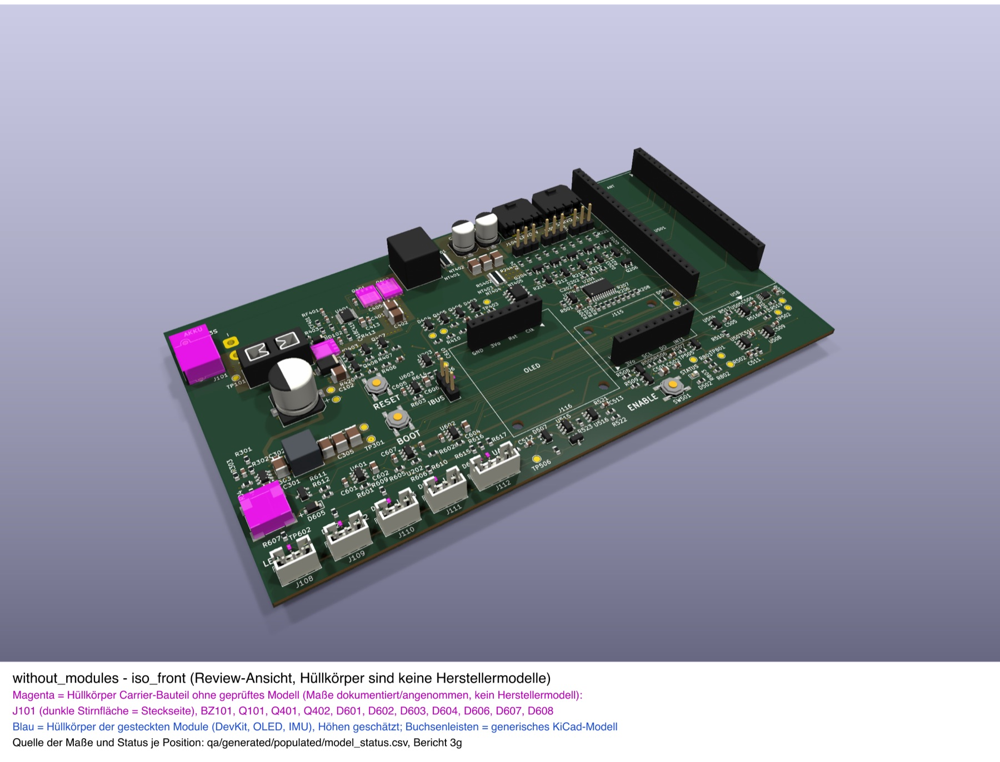 |
| 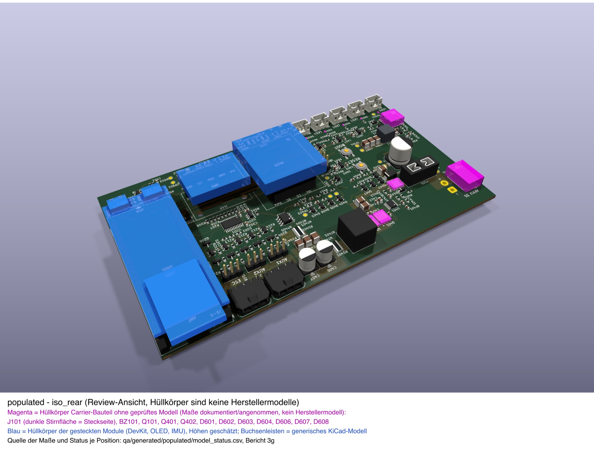 | 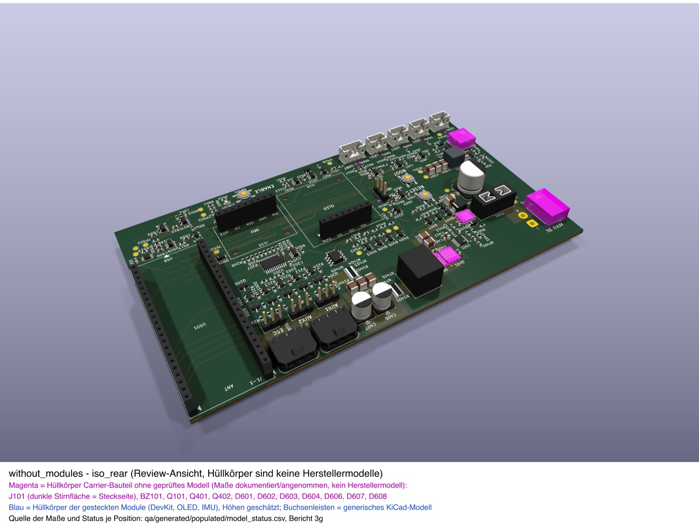 |
| 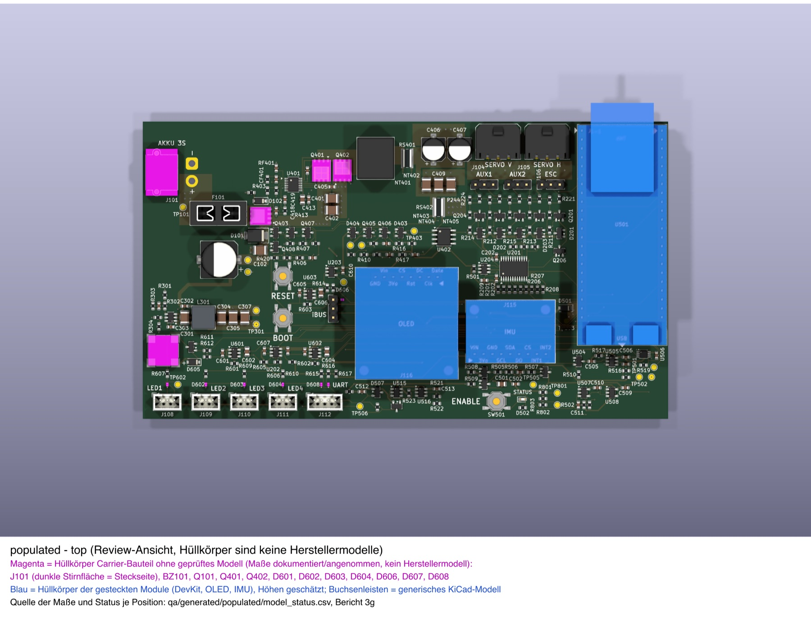 | 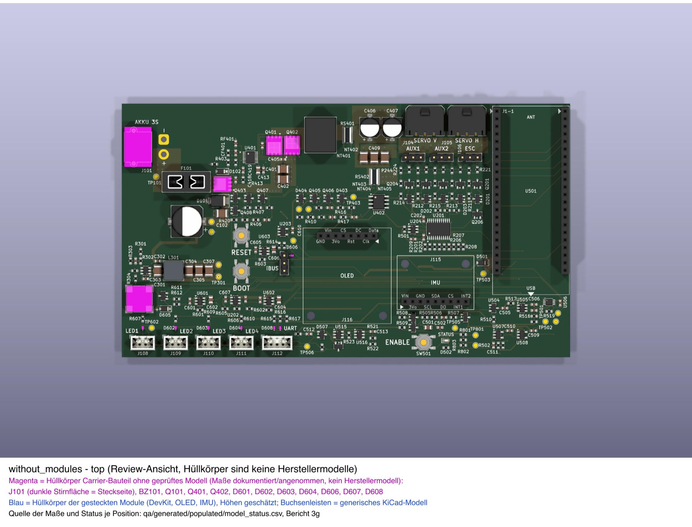 |
| 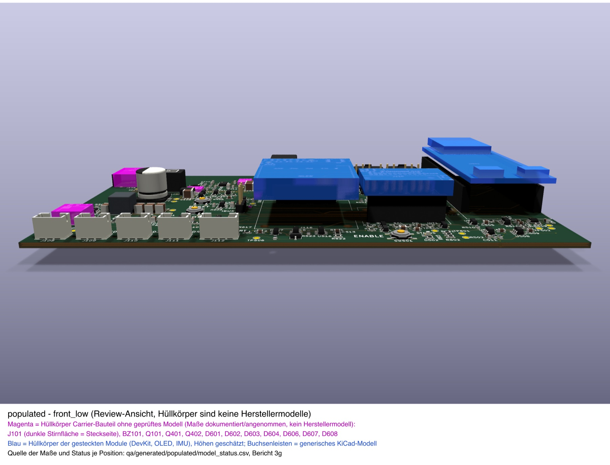 | 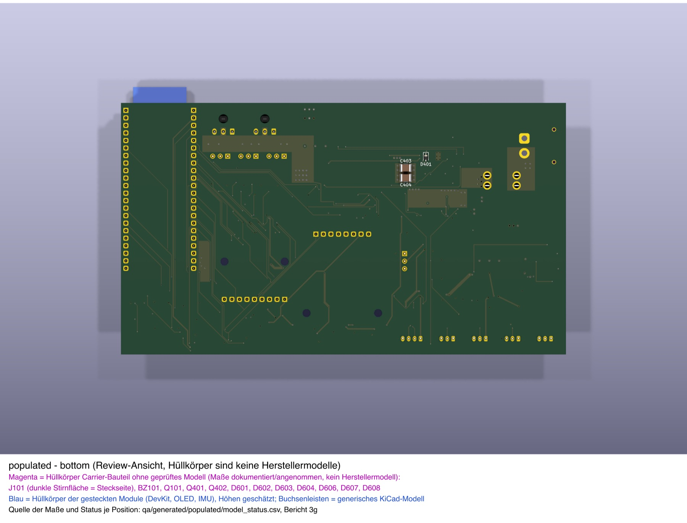 |

Aus den exportierten Gerber- und Bohrdateien gezeichnet:

| Oberseite | Unterseite (von unten) | Innenlage In1 (GND) |
|---|---|---|
| 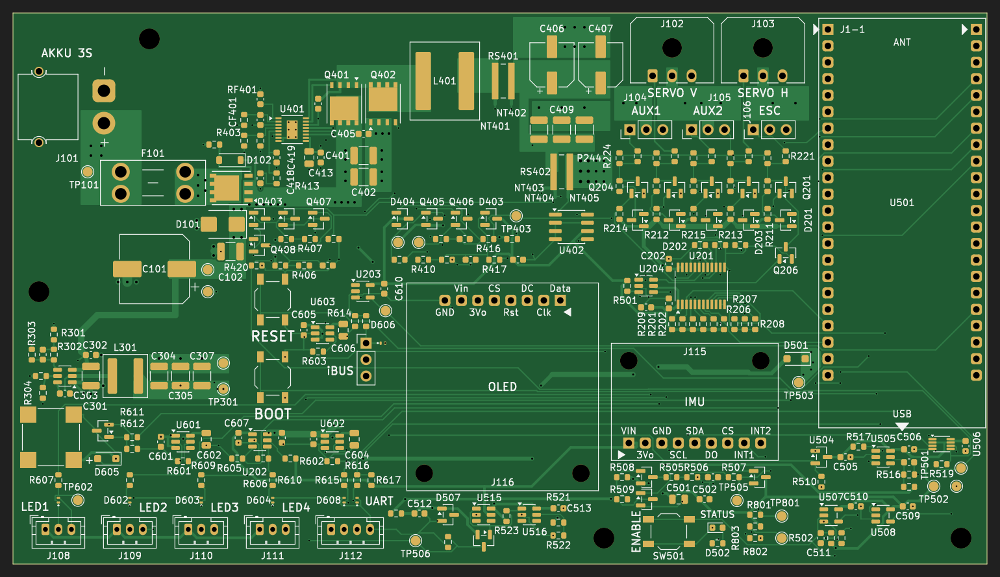 | 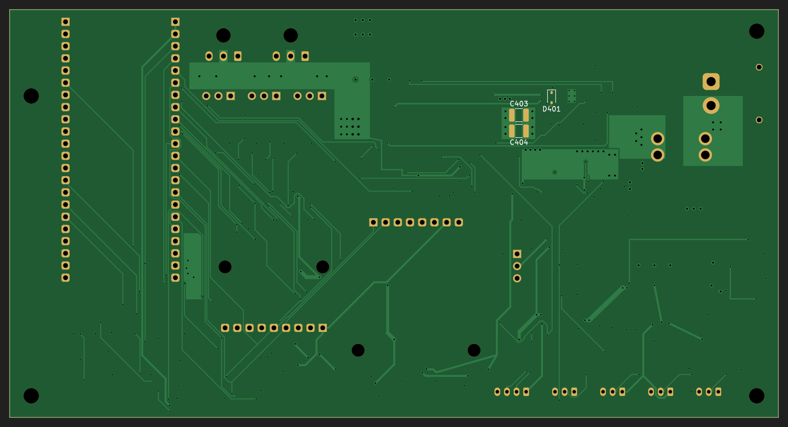 | 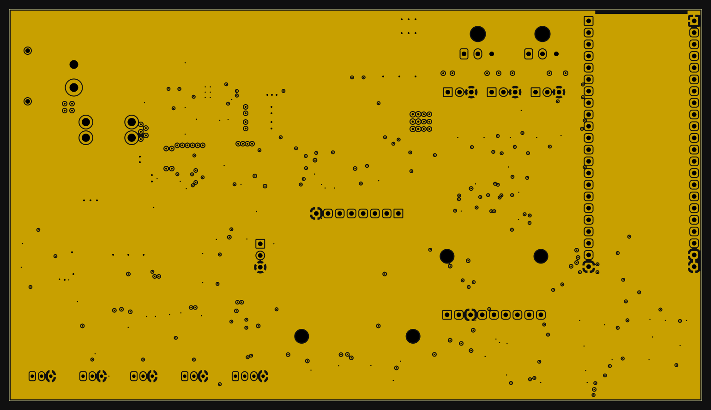 |

## Einstieg

- [Erstinbetriebnahme](bringup.md): Versorgung, D501, Servostrompfad, Abbruchkriterien
- [Versorgung und Boardwahl](vcu/rev1-versorgung-und-boardwahl.md)
- [Pin- und Anschlussplan](vcu/rev1-pin-und-anschlussplan.md)
- [Platzierung, Routing, Fertigung](vcu/rev1-platzierung.md): Strompfade (3j), Fertigerabgleich und DRAFT-Paket (3k)
- Quellen: [GitHub](https://github.com/CagriCatik/RoverCore)
