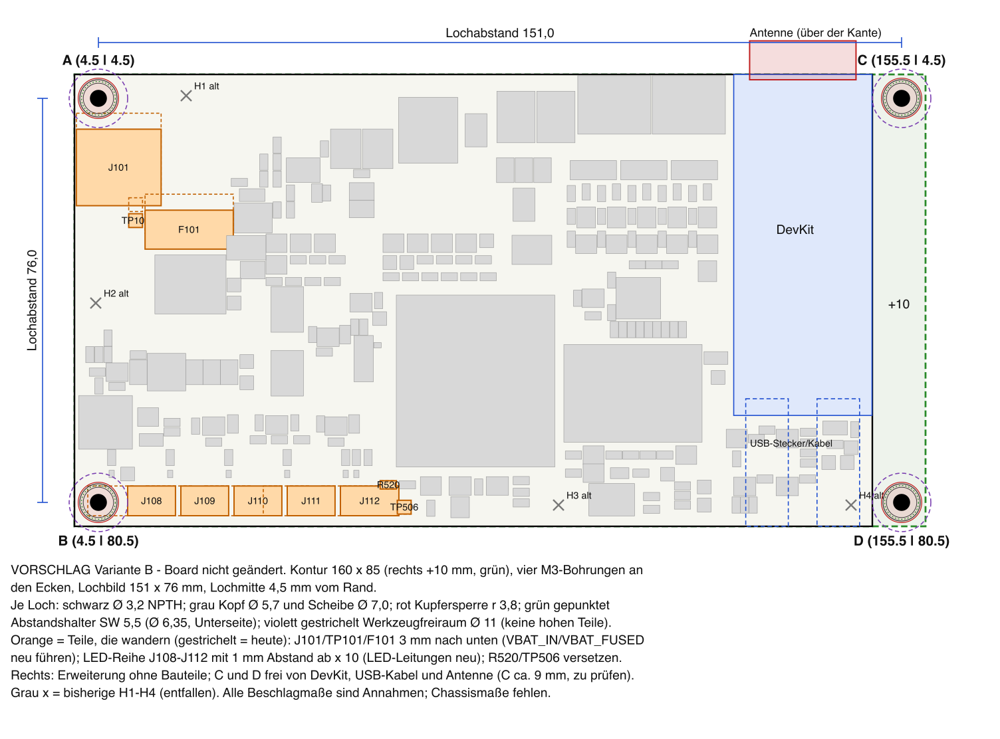

# Rev 1: Lochbild Variante B (mechanische Überarbeitung)

> **Umgesetzt 2026-11-18** (`c19a83d`, Prüfung `6c9dafd`): Variante B, Kontur 160 × 85 mm,
> H1 (4,5 | 4,5), H2 (4,5 | 80,5), **H3 (155,5 | 18,0)**, H4 (155,5 | 80,5). Die Prüfung des
> Umbaus steht unten im Abschnitt „Umsetzung und Prüfung“. Die Lage bleibt vorläufig bis zum
> Fahrzeugabgleich; die Fertigung ist gestoppt.

Stand des Vorschlags 2026-11-18 (vor dem Umbau). Damals galt: **Vorschlag, das Board ist nicht geändert.** Die
Fertigungsvorbereitung ist gestoppt. H1–H4 (Bericht 3n) gelten als
vorläufiger Entwurf: Sie sitzen dort, wo nach dem Routing noch Platz war,
nicht dort, wo die Platine mechanisch gestützt werden sollte. Lokale
Platzierungs- und Routingänderungen sind für das neue Lochbild erlaubt.

(`hardware/scripts/render_mounting_proposal.py`; Annahmen für Schrauben
und Abstandshalter wie in 3n: M3, Bohrung 3,2 mm NPTH, Kopf Ø 5,7 mm, Scheibe
Ø 7,0 mm, Sechskant-Abstandshalter SW 5,5 (Ø 6,35 mm), Kupfersperre r 3,8 mm,
Werkzeugfreiraum Ø 11 mm frei von hohen Teilen, Lochmitte 4,5 mm vom Rand.)

## Was an den vier Ecken heute im Weg steht (Kontur 150 × 85)

Gerechnet mit `mounting_holes.py` (Board-Kopie, nur lesend):

| Ecke | Lochmitte | Hindernis | Eingriff |
|---|---|---|---|
| oben links | (4,5 \| 4,5) | Courtyard J101 (XT30) 2,8 mm statt 5,5 mm | J101 mit TP101 und F101 um 3 mm nach unten; VBAT_IN/VBAT_FUSED-Flächen lokal neu. Platz: zwischen F101 und C101 sind heute 4,1 mm frei |
| unten links | (4,5 \| 80,5) | J108 (LED 1) mit +5V_LED und LED_1_DIN | LED-Reihe J108–J112 ab x 10 mit 1 mm Abstand (heute 2 mm), R520 und TP506 versetzen, LED-Leitungen lokal neu |
| unten rechts | (145,5 \| 80,5) | eine Signalleitung VBAT_OK_BUF; liegt unter dem USB-Kabel | Leitung umlegen; Schraube nur ohne USB-Kabel erreichbar |
| oben rechts | (145,5 \| 4,5) | rechte DevKit-Buchsenleiste (Pads bei x 148,4), DevKit-Hülle, Antenne über der Kante | nur mit Versetzen des DevKits um ca. 10 mm. Das ist ein großer Eingriff: 44 Kontakte und der Signalkanal zwischen den Buchsen |

Folgerung: Auf der heutigen Kontur lassen sich drei Ecken mit lokalen
Änderungen erreichen. Die vierte, oben rechts, geht nur mit einer
Neuplatzierung des DevKits.

## Varianten

| | A: Kontur bleibt 150 × 85 | **B: Kontur 160 × 85 (rechts +10 mm), empfohlen** | C: Kontur 170 × 85 (links und rechts +10 mm) |
|---|---|---|---|
| Lochbild | 3 Ecken; oben rechts nur innen links vom DevKit (x 112–122), dort ebenfalls blockiert (Pads J103, +3V3-Leitung) – DevKit-Feld weiter ohne Stütze | **151 × 76 mm**, alle vier Ecken | 161 × 76 mm, alle vier Ecken |
| Eingriffe | J101-Gruppe, LED-Reihe, VBAT_OK_BUF, für das vierte Loch zusätzlich J103-Umfeld | J101-Gruppe, LED-Reihe; rechte Löcher in der Erweiterung ohne Eingriff | keine Bauteilbewegung; J101 und J108–J112 liegen dann 10 mm von der Kante |
| DevKit-Abstützung | fehlt weiter, Auflage nötig | Löcher C/D direkt neben dem DevKit-Feld; Auflage weiter sinnvoll, aber nicht tragend | wie B |
| USB-Zugang | Schraube unten rechts unter dem Kabel | D außerhalb der USB-Kabelhülle | wie B |
| Antenne | – | C ca. 9 mm von der Antennen-Sperrfläche, zu prüfen | wie B |
| Nachteil | keine echte vierte Ecke | Platine 7 % größer | Platine 13 % größer; Stecker sitzen nicht mehr an der Kante |

**Empfehlung: B.** Sie bringt vier echte Eckpunkte und beschränkt die Eingriffe
auf zwei lokale Bereiche. Das DevKit, das Leistungsteil des Servoreglers und
das übrige Routing bleiben, wie sie sind.

Zu prüfen bei B:
- **Antenne:** Abstand der Metallschraube C zur Antenne des WROOM-Moduls
  gegen die Espressif-Hinweise zum Metallabstand. Sonst C nach unten
  versetzen, etwa auf y ≈ 16; der Abstand zur Antenne steigt dann auf
  ca. 17 mm.
- **J101-Verschiebung:** Sie verändert den Eingangspfad (VBAT_IN →
  F101 → Q101). Danach sind Kupferpfade und Ströme neu zu prüfen
  (`current_map.py vbat`).
- **Neues Board:** GND-Flächen in der Erweiterung, Lochbild, Bestückungsdruck,
  DRC, Parität und Export neu.

## Benötigte Chassis- bzw. Montagemaße

Ohne diese Angaben bleibt jedes Lochbild ein Vorschlag:

1. **Befestigungsfläche:**
   - Chassisboden oder eigene Montageplatte;
   - Material (Metall oder Kunststoff, wegen der Antenne und einer
     möglichen GND-Verbindung);
   - Dicke;
   - vorhandene Bohrungen oder Gewinde mit Koordinaten und Toleranz.
2. **Größte zulässige Platinenkontur:** Länge × Breite, Abstand zu Wänden und
   Kanten, Ausschnitte oder Rippen im Bereich.
3. **Schrauben und Abstandshalter:**
   - Gewindegröße (M3 oder M2,5), Kopfform, Unterlegscheibe;
   - Abstandshalter: Länge, Schlüsselweite, Material (Metall oder Nylon);
   - Durchgangsloch oder Gewinde in der Platte;
   - gewünschte Schwingungsdämpfung (Gummitüllen).
4. **Bauhöhe:**
   - frei über der Platine (DevKit mit USB-Stecker ca. 17,4 mm,
     OLED-Modul ca. 14,7 mm, Schätzwerte aus 3g);
   - frei unter der Platine (THT-Stifte, C403/C404/D401).
5. **Zugänge und Richtungen:**
   - Akkukabel (XT30) und Servokabel (Micro-Fit): Seite und Richtung,
     Kabelführung;
   - LED-, Empfänger- und UART-Kabel;
   - USB-Zugang zum DevKit mit eingebautem Gerät (Öffnung im Gehäuse?);
   - Zugang zu RESET, BOOT und ENABLE von oben;
   - Sichtbarkeit des OLED und der Status-LED.
6. **Antenne:** Lage der WROOM-Antenne zum Chassis, Metallteile in ihrer Nähe,
   gewünschte Abstrahlrichtung.
7. **Werkzeugzugang:** Montage von oben (Schraubendreher oder
   Innensechskant) oder von unten; Reihenfolge mit gesteckten Modulen.

## Nächste Schritte

1. Owner wählt die Variante (A, B oder C) und liefert die Maße oben.
2. Danach Kontur und Lochbild gemeinsam festlegen. Lochbild am Chassis
   prüfen (1:1-Vorlage neu erzeugen).
3. Erst dann die lokalen Änderungen am Board:
   - J101-Gruppe, LED-Reihe, gegebenenfalls VBAT_OK_BUF;
   - neue Montage-Footprints, Kontur, GND-Flächen.
4. Danach DRC, Parität, Kupferpfade (`current_map.py`), Fertigungsexport und
   Paketabgleich neu.

## Umsetzung und Prüfung (2026-11-18)

Werkzeug: `hardware/scripts/mount_rework_b.py` (prepare, holes, route, cleanup, fill).

**Umbau:**
- Kontur 160 × 85 mm, ohne Kupfer in der 10-mm-Erweiterung (GND-Innenlagen weiter 0–150 mm).
- J101 3 mm nach unten. F101 2,4 mm nach unten und 1,4 mm nach links (bei 3 mm hätte sein
  Courtyard den TVS D101 überlappt); TP101 eigener Platz (9,0 | 27,5).
- VBAT_IN-Flächen samt 4 Vias und Unterkante der VBAT_FUSED-Flächen mitgeführt.
- LED-/UART-Reihe J108–J112 ab x 10 mit 1 mm Courtyard-Abstand. R520 (58,5 | 74,9) und
  TP506 (63,0 | 81,4) versetzt.
- Leitungsstücke an den verschobenen Teilen (nur bis zum ersten Via, fremden Pad oder Abzweig)
  entfernt und mit Freerouting neu geführt; alles übrige Kupfer war dabei gesperrt.
- Beschriftungen auf freie Plätze gesetzt.

**H3 und Antenne:** Espressif empfiehlt in den
[Hardware Design Guidelines](https://docs.espressif.com/projects/esp-hardware-design-guidelines/en/latest/esp32s3/pcb-layout-design.html)
für die PCB-Antenne mindestens 15 mm Freiraum „in all directions“ (dort zum Gehäuse); einen
eigenen Wert für Schrauben nennt das Dokument nicht. Bezug ist die Antennen-Sperrfläche des
DevKit-Footprints (aus der Espressif-DXF V1.1, WROOM-Überstand 18,0 × 6,31 mm über der
Oberkante; auf der Platine x 126,9–146,9, y ≤ 1,0). Die Antenne selbst liegt auf dem
gesteckten DevKit ca. 12,6–15,7 mm über der Platine (Schätzung, 3g). Abstand bis zum
**nächsten Rand** der Befestigungsteile bei H3 (155,5 | 18,0):

| Teil | in der Ebene | räumlich (zur Antennenhöhe) |
|---|---|---|
| Scheibe Ø 7,0 | 15,5 mm | 19,7 mm |
| Schraubenkopf Ø 5,7 | 16,2 mm | 19,3 mm |
| Abstandshalter Ø 6,35 (unten) | 15,9 mm | 21,3 mm |

Bei der ersten Lage (155,5 | 16,0) waren es zur Scheibe in der Ebene nur 13,8 mm; deshalb
y 18. Metallteile des Chassis in der Nähe der Antenne sind damit nicht geprüft (Prüfliste M10).

**Kupfervergleich** (`board_copper_diff.py`, Stand vor dem Umbau `1ef7ba8` gegen den
Endstand; Bereiche des Umbaus: x 0–40/y 0–40, x 0–72/y 64–85, Erweiterung x 148–160):
- **Außerhalb der Umbaubereiche: 0 Änderungen.**
- Entfernt 44 Elemente, alle an den verschobenen Teilen:
  - Leitungen: +5V_LED, +5V_EXT, EXT_RX/TX, LED_1–4_DIN, LOCK_SUP, OUT_LOCK, VBAT_PROT, GND;
  - Vias: 1 GND-Via unter dem neuen J109-Pad, 1 VBAT_PROT-Via ohne Anschluss nach der
    Neuführung, 4 VBAT_IN-Vias, die als verschobene Vias wieder dabei sind.
- Hinzugefügt 75 Elemente, nur Leitungen dieser Netze, 2 GND-Vias und 1 LED_1_DIN-Via.
- **Vias gesamt:** 307 vorher, 308 nachher (GND 103 → 104).
- **Die 75 Vias aus dem fehlerhaften Aufräumlauf** fehlen nicht: Jener Lauf betraf eine
  Arbeitskopie, die danach aus der Sicherung nach dem Routing wiederhergestellt wurde. Der Endstand
  ist nach dieser Wiederherstellung entstanden.
- **52 Splitter beseitigt:** Freerouting hatte außerhalb der Bereiche 52 Leitungssplitter
  (< 0,1 mm, 51 davon < 0,01 mm) an Pads angefügt. Sie sind entfernt
  (`remove_import_slivers.py`); die Verbindungen bestanden schon vorher.
- DRC (alle Schweregrade): 0 Verstöße, 0 offene Verbindungen. Parität PASS.

**Strompfade** (`current_map.py`, gleiche Modell- und Lastannahmen vorher/nachher, DC, 20 °C,
Schätzung; neue Fälle `vbat_in`, `vbat_fused`):

| Pfad | Last | vorher | nachher |
|---|---|---|---|
| VBAT_IN J101 → F101 (Raster 0,1) | 10,1 A | 1,89 mV, max. 1,16 A/mm | 1,48 mV, max. 1,07 A/mm |
| VBAT_FUSED F101 → Q101 (0,1) | 10,1 A | 2,24 mV, max. 3,00 A/mm | 2,50 mV, max. 2,82 A/mm |
| VBAT_PROT Q101 → Q401 (0,1) | 9,35 A | 24,2 mV | 24,2 mV |
| GND-Rückweg J102 / J103 → J101 (0,15, ganze Platine) | 5,1 A je | 11,4 / 12,1 mV | 11,1 / 11,7 mV |
| +5V_LED U601 → J108–J111 | je 0,08 A | 6,2–9,3 mV | 6,9–8,1 mV |
| +5V_EXT U602 → J112 | 0,30 A | 5,7 mV | 6,4 mV |

Keine wesentliche Verschlechterung im untersuchten DC-Fall. VBAT_FUSED ist beim Spannungsabfall
leicht schlechter geworden (2,24 → 2,50 mV), seine höchste berechnete Stromdichte sinkt (3,00 → 2,82 A/mm);
+5V_EXT steigt von 5,7 auf 6,4 mV. Eine Erwärmungsrechnung ist das nicht (siehe 3j).

**Steckerzugang:**
- **J101 XT30:** Der Gegenstecker (XT30-Buchse) steckt von links über die Kante und liegt
  außerhalb der Platine. Zur Scheibe von H1 bleiben in y gut 3 mm Griffraum. Das Kabel geht
  nach links. Die 3-mm-Verschiebung ändert die Steckrichtung nicht.
- **J108–J112 JST PH, senkrecht:** Gegenstecker PHR stecken von oben, Kabel gehen nach oben.
  Der Abstand zwischen den Leisten-Gehäusen (F.Fab) sinkt von 2,58 auf **1,58 mm**. PH hat keine
  Verriegelung; der Stecker hält durch Reibung.
  - Seitlich lässt sich ein Stecker zwischen den Nachbarn kaum greifen.
  - Ziehen geht an der Vorder- und Rückseite des Steckers (zur Kante bzw. zu den niedrigen
    ESD-Dioden hin) oder mit Pinzette bzw. Zange am Gehäuse, nicht an den Litzen.
  - Die Breite der PHR-Stecker konnte ich nicht aus dem JST-Datenblatt bestätigen (jst-mfg.com
    war nicht abrufbar). Am Muster mit echten Steckern prüfen.
  - Reicht es nicht, die Reihe weiter nach rechts ziehen; dafür müssen R520, TP506, C512 und
    D507 lokal weichen.
- **H2 mit gestecktem J108:** Der Werkzeugfreiraum Ø 11 bleibt frei; der Stecker liegt in der
  Leistenfläche.
- **DevKit / USB:** H3 und H4 liegen außerhalb des DevKit-Felds und der USB-Kabelhülle. Bis zum
  DevKit-Rand sind es ca. 5,6 mm von der Lochachse; ein Schraubendreher geht von oben auch mit
  gestecktem Modul.
- **J102/J103, Taster und OLED:** unverändert.

**Nicht automatisch gestrichen: die Auflage unter dem DevKit.** H3/H4 stützen jetzt die rechte
Seite. Ob die Durchbiegung beim Einstecken klein genug bleibt, zeigt erst der Stecktest
(Prüfliste M9).

**Unterlagen:** Die Render-Skripte lesen Lochlagen und Kontur aus dem Board (kein eingetragener
Wert mehr):
- 1:1-Vorlage `render_mounting_print.py`;
- bemaßte Draufsicht `render_mounting_drawing.py`;
- 3D-Bilder `render_populated_review.py`;
- Lückenkarte `render_placement_review.holes_on_board`.

`mounting_holes.py place` ist stillgelegt, die Suche bleibt.

**Fertigungsdaten:**
- Neues Paket `manufacturing/releases/generated/rev-A2-DRAFT` (NO-GO), Paketabgleich 0 Fehler:
  - NPTH 10 = Board;
  - PTH 417 = Board, innerhalb 0,0005 mm.
- `rev-A1-DRAFT` und `rev-A0-tooling-DRAFT` sind überholt und mit `SUPERSEDED.txt`
  gekennzeichnet; nicht verwenden.
